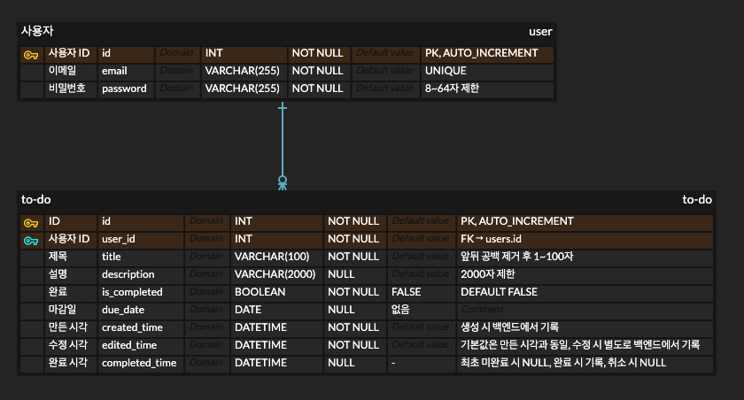

# StepTodo 백엔드

회원가입·로그인 후 내 할 일을 등록하고, 기한을 정하고, 끝낸 일을 체크하는 개인용 To-do 서비스의 API 서버다.
익숙한 기능을 직접 만들면서 **요구사항 → API·DB 설계 → 구현 → 테스트 → 배포** 흐름을 익히는 게 목표다.
첫 버전부터 인증과 사용자별 데이터 접근 제한을 포함한다.

- **API 계약: [frontend/API.md](../frontend/API.md)를 따른다.** 프론트엔드는 이 명세대로 만들어져 있어서, 같은 요청·응답을 주면 화면을 고치지 않고 연결된다.
- **진행 상태: 1단계(회원가입·로그인) 구현 중.** 화면은 아직 Mock API로만 검증했고 실제 백엔드와 연동하지 않았다.
- 이 문서는 프로젝트 기획 명세를 정리한 것이다. 기획 명세와 API.md가 다른 부분은 **API.md의 합의 결과를 따랐다**([아래 표](#기획-명세에서-바뀐-점)).

## 기술 스택

| 구분 | 기술 | 용도 |
| --- | --- | --- |
| 언어 | Python 3.10+ | 백엔드 개발 |
| API | FastAPI · Pydantic | REST API와 요청 데이터 검증 |
| DB | MySQL | 사용자·할 일 데이터 저장 |
| ORM | SQLAlchemy | 조회·저장·트랜잭션 처리 |
| DB 변경 관리 | Alembic | 테이블 구조 변경 이력 관리 |
| 인증 | JWT(PyJWT) · 비밀번호 해싱 | 로그인과 사용자별 접근 제한 |
| 이메일 인증 | SMTP · Redis | 가입 전 인증코드 발송·확인 ([API.md §2.1](../frontend/API.md#21-이메일-인증-smtp--redis)) |
| 테스트 | pytest | 주요 기능·권한·동작 규칙 검증 |

운영·배포 단계에서는 Docker Compose, Nginx, Kubernetes(kind, 로컬 실습용), GitHub Actions, Amazon ECR·ECS Fargate·RDS for MySQL·CloudWatch를 쓴다.

## 폴더 구조

```
backend/
├── app/                    실행 기준 폴더 (import는 app/를 루트로 한다. 예: from user.domain.model import User)
│   ├── main.py             FastAPI 앱
│   ├── config.py           설정 (환경 변수 읽기)
│   ├── user/
│   │   ├── domain/         User 모델, 리포지토리 인터페이스(IUserRepository)
│   │   ├── infra/          리포지토리 구현 (DB 접근)
│   │   └── services/       UserService (회원가입 등 유스케이스)
│   ├── todo/               Todo 모델
│   └── utils/crypto.py     비밀번호 해시·검증
├── assets/db_erd.png       DB ERD
├── tests/                  pytest
├── pyproject.toml          의존성 (uv로 관리)
└── uv.lock
```

## 실행하기

[uv](https://docs.astral.sh/uv/)로 의존성을 관리한다.

```bash
cd backend
uv sync                      # 의존성 설치 (.venv 생성)
cd app
uv run fastapi dev main.py   # http://127.0.0.1:8000, API 문서는 /docs
```

### 필요한 설정

아래 값은 **환경 변수로 주입한다. 코드·저장소·이미지에 넣지 않는다.**

- MySQL 접속 정보
- JWT 서명 키
- SMTP 계정 (인증코드 메일 발송)
- Redis 접속 정보 (인증코드·재발송 대기·인증 완료 기록)

프론트엔드(`:5500`)와 출처가 다르면 CORS에서 `Authorization`·`Content-Type`·`X-Request-ID` 헤더를 허용해야 한다([API.md §9](../frontend/API.md#9-필요한-백엔드-설정)).

## 만들 기능

### 회원·인증

- 이메일 인증(인증코드) 후 이메일·비밀번호·이름으로 회원가입하기
- 로그인하기 (OAuth2 Password form, JWT 발급)
- 현재 로그인한 사용자 확인하기 (`GET /api/me`)
- 인증이 없거나 만료되면 `401`로 응답하기
- 본인의 할 일만 조회·수정·삭제하기

로그아웃은 화면에서만 처리한다. 로그아웃 API는 없다.

### 할 일 관리

- 할 일 추가하기
- 목록과 상세 내용 보기
- 제목·설명·마감일 수정하기
- 완료 체크하고 다시 취소하기
- 할 일 삭제하기
- 전체·미완료·완료로 걸러 보기
- 최신순·마감일순으로 정렬하기
- 목록을 일정 개수씩 나눠 보기

엔드포인트 목록과 요청·응답 형식은 [API.md §1](../frontend/API.md#1-엔드포인트-요약)에 있다.

## 저장할 정보



### 사용자 `users`

| 항목 | 규칙 |
| --- | --- |
| ID | 서버에서 생성. API 응답에서는 정수 |
| 이메일 | 필수, 중복 가입 불가. 앞뒤 공백 제거·**소문자로 바꿔 저장·비교**, 최대 254자 |
| 비밀번호 해시 | 원문 대신 해시를 저장. 응답·로그에 넣지 않음. 원문 규칙은 8~64자(문자 수), 자르지 않음, 조합 강제 없음 |
| 이름 | 필수. 앞뒤 공백 제거 후 1~20자, 내부 공백 포함. 중복 허용. 응답의 `name`, 화면 상단에 "OO님"으로 표시 |
| 생성 시각 | 서버에서 자동 기록. 응답의 `created_at` |

### 할 일 `todos`

| 항목 | 규칙 |
| --- | --- |
| ID | 서버에서 생성. 정수 |
| 소유자 | `users.id`를 가리키는 외래 키(NOT NULL). 서버가 토큰의 사용자로 지정. 응답에 넣지 않음 |
| 제목 | 필수. 앞뒤 공백 제거 후 1~100자, 내부 공백 포함. 같은 제목 중복 허용 |
| 설명 | 선택, 최대 2,000자. 비어 있으면 `null` |
| 완료 여부 | 처음에는 미완료 |
| 마감일 | 선택, 시간 없이 날짜만. 과거 날짜 허용 |
| 생성·수정 시각 | 서버에서 자동 기록. 내용이나 완료 상태가 바뀌면 수정 시각 갱신 |
| 완료 시각 | 완료하면 기록, 취소하면 `null`. 이미 완료된 항목을 다시 완료해도 처음 값 유지 |

- 길이는 Python `len()`과 같은 유니코드 코드 포인트 기준으로 센다. 화면도 같은 기준이다.
- 시각은 UTC로 저장하고, 응답에는 시간대(`Z`)를 붙인다. MySQL `DATETIME`은 시간대를 저장하지 않는다.
- API 응답의 필드 이름은 `created_at`·`updated_at`·`completed_at`이다. DB 컬럼 이름이 다르면 응답 스키마에서 바꿔 준다.
- 목록 정렬용 인덱스로 `(user_id, created_at)`, `(user_id, due_date)`를 검토한다.

## 미리 정해둔 규칙

### 인증·접근 제한

- **가입 전에 이메일 인증을 한다.** 형식 검사 → 인증코드 발송(SMTP) → 코드 확인 → 가입. 코드·재발송 대기·인증 완료 기록은 Redis에 둔다. 세부 값(코드 6자리, 유효 5분, 재발송 60초, 5회 시도, 인증 유효 30분)은 [API.md §14](../frontend/API.md#14-이메일-인증-세부-합의).
- 회원가입 성공 후 사용자가 직접 로그인한다. 자동 로그인하지 않는다.
- 로그인에 성공하면 JWT access token(HS256, 60분)을 발급한다. 클레임은 `sub`(사용자 id)와 `exp`만 넣는다.
- 사용자 정보와 할 일 API 요청에는 `Authorization: Bearer <JWT>`를 보낸다.
- refresh token과 서버 쪽 토큰 폐기는 구현하지 않는다. 로그아웃해도 이미 발급된 토큰은 만료 전까지 유효하다.
- 할 일의 소유자는 클라이언트 입력을 믿지 않고 서버가 정한다. 생성 본문에 `user_id`·`owner_id` 같은 필드가 오면 `422`(`extra="forbid"`)로 거절한다.
- 목록과 전체 개수도 로그인한 사용자의 데이터만 반환한다.
- **다른 사용자의 할 일에 접근하면 `403`, 없는 id는 `404`**로 응답한다. id로 찾은 뒤 주인을 확인한다.
- 인증이 없거나 유효하지 않으면 `401`로 응답한다. 로그인 실패도 `401`이고, 없는 이메일과 틀린 비밀번호에 같은 문구를 쓴다.

### 할 일

- 같은 제목으로 여러 개 등록해도 된다.
- 첫 버전에서 POST 재전송에 따른 중복 생성 방지는 보장하지 않는다.
- 한국 날짜(Asia/Seoul) 기준으로 마감일이 지났고 아직 미완료면 기한 초과다. 오늘이 마감이면 초과가 아니다.
- 완료한 할 일도 수정할 수 있다. 수정해도 완료 상태와 완료 시각은 그대로다.
- 정렬: 최신순은 `created_at` 내림차순 → `id` 내림차순. 마감일순은 `due_date` 오름차순, **날짜 없는 항목은 맨 뒤** → 같으면 최신순.
- 삭제하면 복구할 수 없다. 확인은 화면에서 받는다.

### 오류 응답

FastAPI 기본 형식(`{"detail": ...}`)을 쓴다. 전체 표는 [API.md §8](../frontend/API.md#8-오류-응답).

| 상황 | 상태 코드 |
| --- | --- |
| 토큰 없음·무효·만료, 로그인 실패 | `401` |
| 틀리거나 만료된 인증코드 | `400` |
| 남의 할 일, 이메일 미인증 상태로 가입 | `403` |
| 없는 할 일 | `404` |
| 이미 가입된 이메일 | `409` |
| 인증코드 재발송 대기·시도 초과 | `429` |
| 입력 형식 위반 (이메일 형식, 길이, 잘못된 쿼리 등) | `422` (Pydantic 기본 `detail` 배열) |

- 화면은 `422`의 `loc: ["body", "<필드>"]`를 보고 해당 입력칸 아래에 `msg`를 표시한다. 직접 `HTTPException(422, "문자열")`을 던지면 칸에 연결되지 않으므로, 형식 검증은 요청 스키마(`EmailStr`, `StringConstraints` 등)에 맡긴다.
- `422` 응답과 서버 로그에서 `input` 값(특히 비밀번호)을 뺀다.
- 서버 로그에 `Authorization` 헤더, 비밀번호, 인증코드를 남기지 않는다. 화면이 보내는 `X-Request-ID`는 로그에 남긴다.

## 이렇게 나눠서 만든다

| 단계 | 내용 | 통과 기준 |
| --- | --- | --- |
| **1. 회원가입·로그인** ← 지금 | DB 구조 설계, 이메일 인증·회원가입·로그인·현재 사용자 조회 | 사용자가 저장되고, 발급된 JWT로 현재 사용자를 조회하며, 잘못되거나 만료된 토큰은 거절된다 |
| 2. 할 일 저장·변경 | 등록·조회·수정·삭제·완료 전환 | 재시작 후에도 데이터가 남고, 다른 사용자의 할 일을 읽거나 변경할 수 없다 |
| 3. 목록 조회 다듬기 | 필터·정렬·페이지 조회, 잘못된 입력 처리 | 본인 데이터에만 조건이 적용되고, 목록과 전체 개수가 정확하다 |
| 4. 첫 버전 완성 | 화면을 실제 API에 연결, Docker Compose(API·DB·Redis)로 함께 실행, 테스트·실행 방법 정리 | 회원가입부터 로그아웃까지 화면에서 동작하고, 사용자 전환 시 이전 데이터가 남지 않으며, 오류를 로그에서 확인할 수 있다 |
| 5. Kubernetes | 로컬 kind에서 확장·자동 복구·업데이트·롤백, DB는 PVC | Pod 자동 복구와 버전 롤백을 확인하고, DB Pod를 다시 만들어도 데이터가 남는다 |
| 6. AWS 배포 | ECS Fargate·RDS MySQL·로드 밸런서·HTTPS | 내 컴퓨터를 꺼도 서비스를 쓸 수 있고, 컨테이너 교체 후에도 데이터가 유지된다 |
| 7. 자동화 | GitHub Actions로 테스트 → 이미지 빌드 → ECR → ECS 배포 | 테스트 실패 시 배포되지 않고, 정상 변경은 자동 반영되며, 이전 버전으로 복구할 수 있다 |
| 8. 모니터링 | CloudWatch 로그·지표·알람 | 일부러 낸 오류나 부하를 지표와 로그로 확인하고, 알람 동작을 검증한다 |

연동 확인용 `curl` 순서는 [API.md §12](../frontend/API.md#12-연동-확인-순서)에 있다.

## 지금은 안 만들 것

반복 일정, 태그, 우선순위, 하위 할 일, 공유, 파일 첨부, 마감 알림, AI·RAG 기능, 비밀번호 재설정, 소셜 로그인, 로그인 시도 횟수 제한.
동시성 심화와 중복 생성 방지는 필수 범위 이후의 선택 과제로 둔다.

## 끝내기 전에 확인하기

- [ ] 이메일 인증·회원가입·로그인·로그아웃과 인증 만료 처리가 동작한다.
- [ ] 다른 사용자의 할 일에 접근할 수 없다.
- [ ] 재시작 후에도 사용자와 할 일이 남아 있다.
- [ ] 수정·완료·취소·삭제·필터·정렬·페이지 조회가 정확하다.
- [ ] 잘못된 입력과 없는 항목을 처리한다.
- [ ] 주요 기능과 권한을 테스트로 확인했다.
- [ ] 비밀번호·토큰·비밀키·인증코드가 응답이나 로그·코드에 노출되지 않는다.
- [ ] 실행·배포·복구·AWS 자원 정리 방법을 기록했다.

## 기획 명세에서 바뀐 점

기획 명세와 API.md가 달랐던 부분이다. API.md의 합의를 따른다.

| 항목 | 기획 명세 | 따르는 규칙 (API.md) |
| --- | --- | --- |
| 다른 사용자의 할 일 접근 | `404` | **`403`**, 없는 id만 `404` ([§13 #7](../frontend/API.md#13-합의-결과)) |
| 이메일 인증 | 없음 | 가입 전 SMTP 인증코드 확인 필수 ([§2.1](../frontend/API.md#21-이메일-인증-smtp--redis)) |
| Redis | 필수 범위 이후의 선택 과제 | 이메일 인증에 쓰므로 **1단계부터 필요** |
| 사용자 이름 | 없음 | **`name` 필수**(1~20자). 가입 요청·응답과 `/me`에 포함 ([§13 #14](../frontend/API.md#13-합의-결과), 2026-11-14 추가) |

## 현재 코드에서 맞출 것

API.md와 아직 맞지 않는 부분이다. 해결하면 이 목록에서 지운다.

- [ ] 중복 이메일: `UserService.create_user`가 `422`를 던진다 → `409` + `{"detail": "이미 가입된 이메일입니다."}`
- [ ] 이메일 정규화: 앞뒤 공백 제거·소문자 변환 없이 검사·저장한다
- [ ] 사용자 id: `User.id`는 `int`로 선언돼 있는데 서비스는 ULID 문자열을 넣는다. ERD와 API는 정수다
- [ ] ERD 이미지(`assets/db_erd.png`)에 사용자 `created_at` 컬럼 반영 (모델·마이그레이션에는 추가됨)
- [ ] 비밀번호 해시: `utils/crypto.py`가 bcrypt를 쓴다. bcrypt는 72바이트까지만 써서 한글 64자(최대 192바이트)가 잘린다 → argon2(이미 의존성에 있는 `pwdlib[argon2]`)를 검토한다
- [ ] `UserRepository`(infra)가 비어 있다
